# SiteVault — visual site organizer and offline account vault for Windows

**SiteVault is a free, portable Windows app that turns your links into an endless visual map of cards.** Draw a category, drop sites into it, colour them, and every link stays one click away. Alongside the map it keeps a local account vault for your logins.

One `.exe`. No installer, no sign-up, no cloud, no telemetry. Works offline, runs on Windows 10 and 11, 32-bit and 64-bit.

> This repository hosts the **downloadable application only**. It contains no source code. Builds are produced from a private source tree; the release assets here are the finished program.

📥 **[Download the latest release](../../releases/latest)** · `SiteVault-5.0.0-portable.zip`

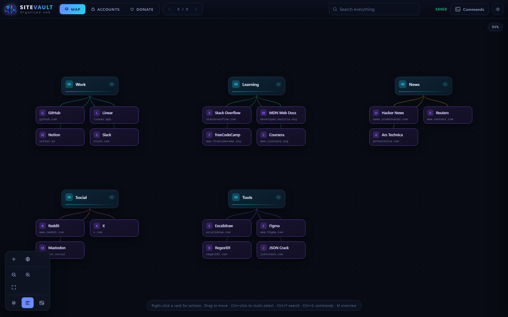

---

## Download and run

1. Open the [latest release](../../releases/latest) and download `SiteVault-5.0.0-portable.zip`.
2. Right-click the zip → **Extract All**. (Windows' built-in extractor is fine.)
3. Open the extracted folder and double-click **`SiteVault.exe`**.
4. If Windows shows a SmartScreen prompt for an unsigned app, click **More info → Run anyway** — or verify the file first with the SHA-256 listed in the release notes.
5. On the very first run on a machine that has never had the Microsoft WebView2 Runtime, SiteVault installs that one runtime silently from Microsoft and then starts. Nothing else is ever downloaded.
6. A starter map appears. Everything you do after that is saved automatically.

Nothing is installed and nothing needs uninstalling: the app is a single file you can keep on a USB stick, a network share or your desktop.

**Requirements:** Windows 10 or 11 (32-bit or 64-bit), about 90 MB of RAM at rest.

---

## What it does

**A map instead of a list**
- An endless canvas where categories and sites are draggable cards; positions are saved exactly where you put them.
- Zoom from 1% to 420%. Cards stay readable down to 18% zoom, then collapse into compact colour blocks so huge maps stay smooth.
- Multi-select with `Ctrl+click`, box-select with `Shift+drag`, and drag whole selections together.
- Align helper (on by default) nudges a card into line with its neighbours in the same category; drag further and it stays exactly where you drop it.
- Right-click any site to give it its own card colour, border colour and connector colour.
- Overview map with two modes — everything at once, or just the area you are working in.

**Search that suggests as you type**
- The header box searches categories, sites and accounts and lists them in three separate groups while you type.
- `Ctrl+F` or `/` opens it from anywhere; `Ctrl+K` opens the command palette.
- Matching cards are highlighted and the rest dim, with instant jump to a result.

**A local account vault**
- Keep the logins that belong to your sites: name, key, address, group, notes.
- Strength and reuse warnings, one-click copy, optional clipboard auto-clear after 30 seconds, sorting by site, group, age or weakness.
- There is deliberately **no master password and no lock screen**, so nothing can lock you out of your own file. Your data file is a normal file: keep it private like any other.

**Looks you can make your own**
- 16 themes, an accent colour, card style, corner radius, glow, font, background pattern and connector style.
- Optional service logos, per-category tinting, solid background and card shadows.
- One switch (`Animations and flow`) removes every animation for an instant interface.
- Starter templates: `Starter map`, `Developer`, `Designer`, `Student`, `Everyday` and a blank canvas — applied in one click and undoable.

**Data you can get back out**
- Everything is stored in one plain JSON file: `%APPDATA%\SiteVault\sitevault_data.json`.
- Backups include every card, every position, every colour and every preference; restore by replacing or merging.
- Import browser bookmarks, export CSV, export a printable HTML report, and step back through up to 200 undo levels.

---

## Screenshots

| Search | Accounts |
| --- | --- |
| 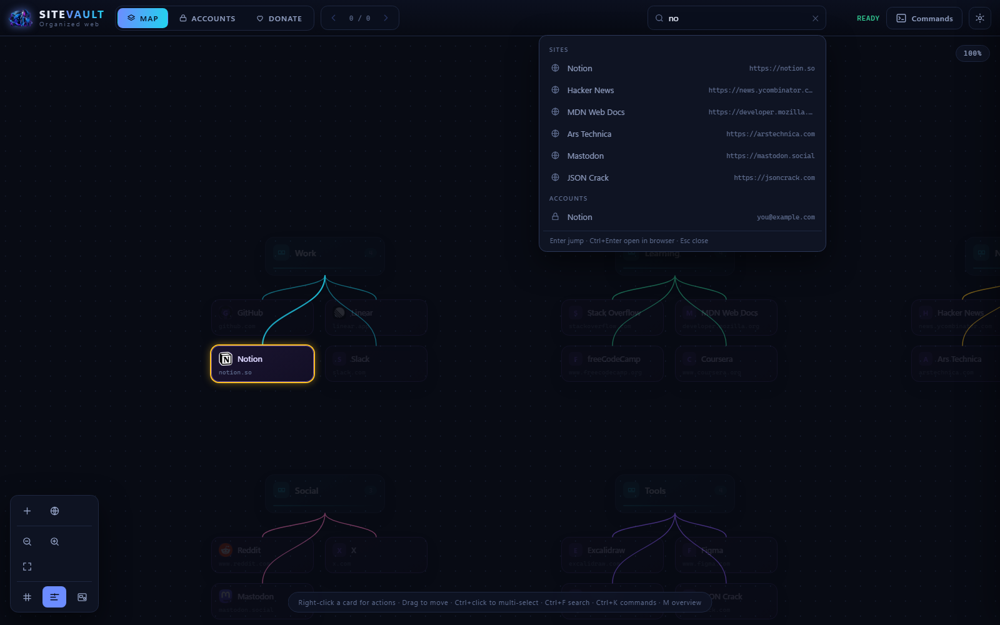 | 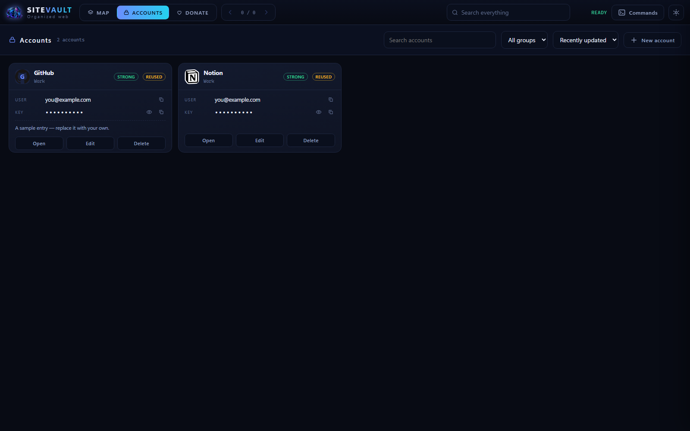 |

| Settings | Appearance |
| --- | --- |
| 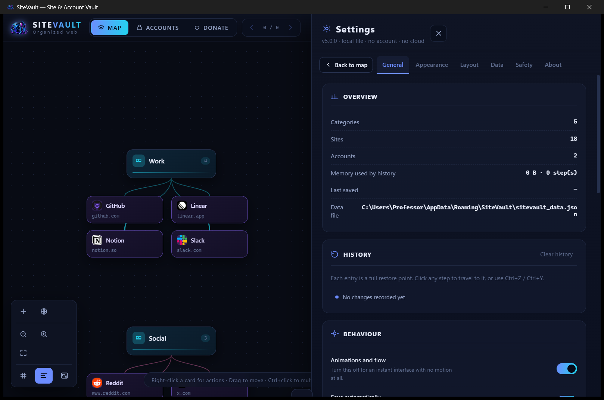 | 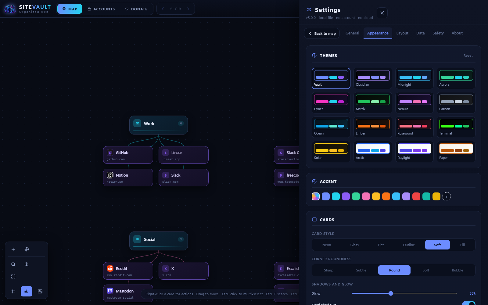 |

| Starter templates | Custom colours |
| --- | --- |
| 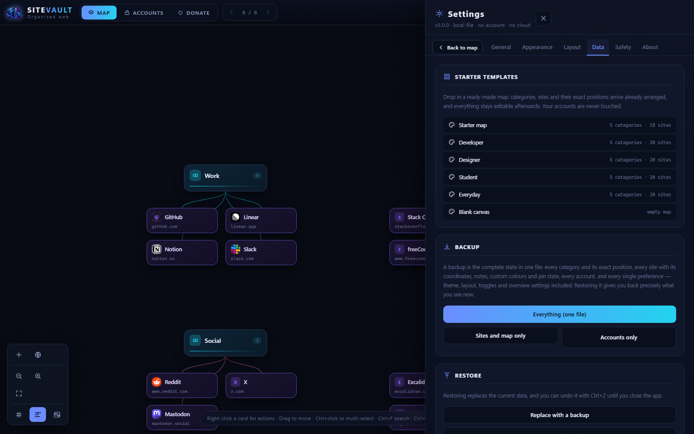 | 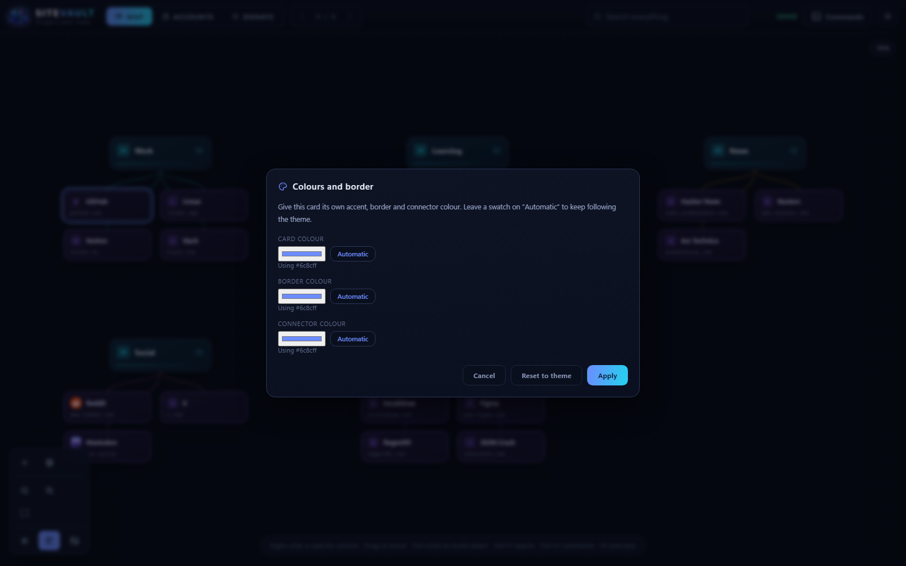 |

| Overview map | A loaded template |
| --- | --- |
| 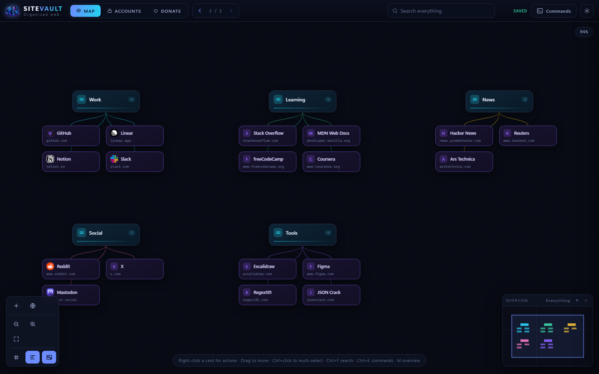 | 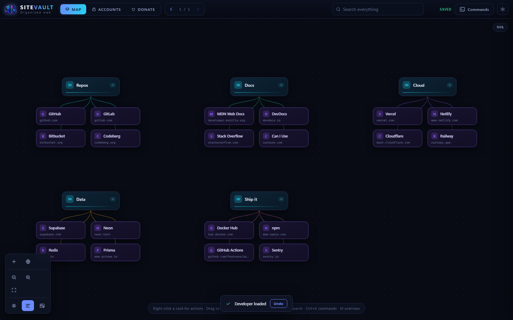 |

| Donate | Shortcuts |
| --- | --- |
| 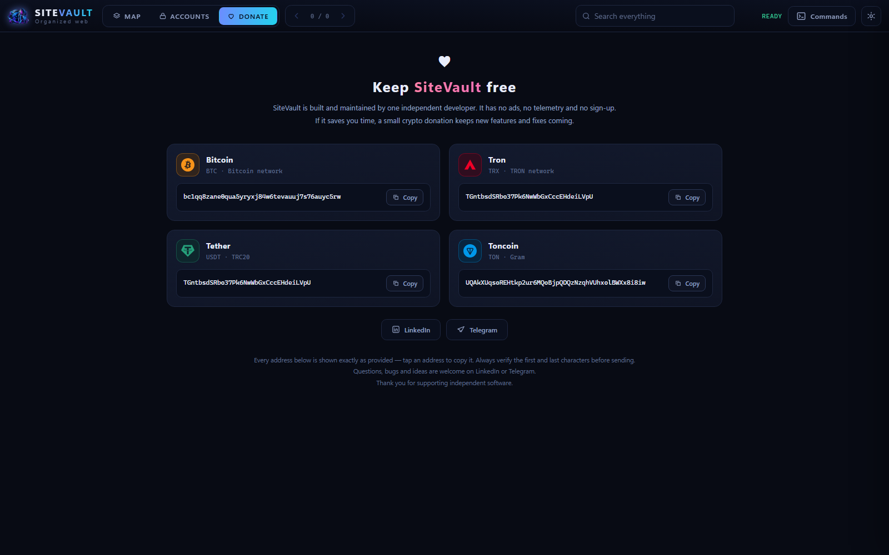 | 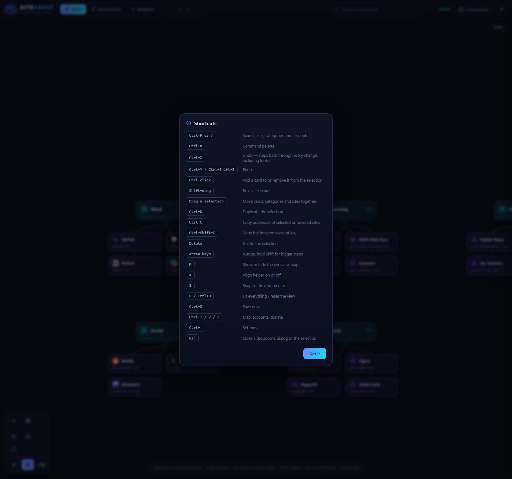 |

The packaged app in its native window:

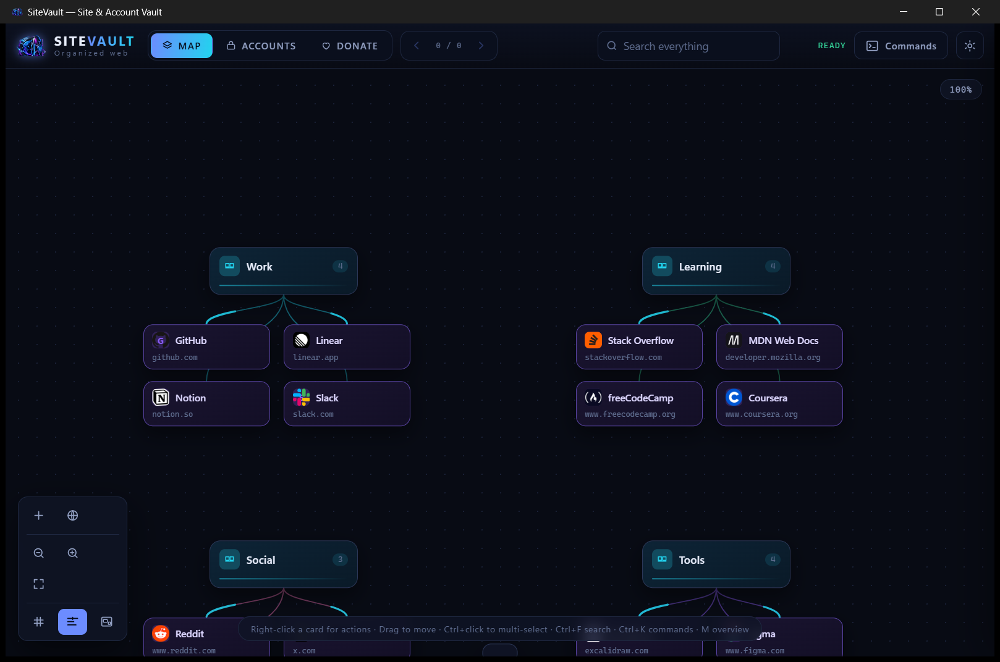

---

## Keyboard shortcuts

| Keys | Action |
| --- | --- |
| `Ctrl+F` or `/` | Search sites, categories and accounts |
| `Ctrl+K` | Command palette |
| `Ctrl+Z` / `Ctrl+Y` | Undo / redo every change, including looks |
| `Ctrl+click` | Add a card to or remove it from the selection |
| `Shift+drag` | Box-select cards |
| `Ctrl+D` | Duplicate the selection |
| `Ctrl+C` / `Ctrl+Shift+C` | Copy a site address / the hovered account key |
| `Delete` | Delete the selection |
| Arrow keys | Nudge, hold `Shift` for bigger steps |
| `M` | Show or hide the overview map |
| `A` / `S` | Align helper / snap to grid |
| `F` or `Ctrl+0` | Fit everything / reset the view |
| `Ctrl+S` | Save now |
| `Ctrl+1` / `Ctrl+2` / `Ctrl+3` | Map · Accounts · Donate |
| `Ctrl+,` | Settings |
| `Esc` | Close a dropdown, dialog or the selection |

---

## Privacy

- No accounts, no sign-in, no analytics, no crash reporting, no ads.
- No network requests at all unless **Load service icons** is on, which asks `icons.duckduckgo.com` for one favicon per visible site. Switch it off and SiteVault never touches the internet.
- Links always open in your own default browser; there is no built-in browser.
- Developer tools, the browser context menu, page zoom and the status bar are disabled in the shipped build.
- Built with stack protection, DEP, ASLR and high-entropy ASLR; not packed or obfuscated, and free of the "packer" patterns that make antivirus software suspicious.

**Verify your download** with the SHA-256 published with each release:

```powershell
Get-FileHash .\SiteVault-5.0.0-portable.zip -Algorithm SHA256
```

---

## Frequently asked

**Is it a bookmark manager?** It can replace one — it is a visual site organizer with categories you draw yourself, plus a one-step browser-bookmark import.

**Does it store passwords?** It keeps a local account vault (user name, key, address, group, notes) with strength and reuse warnings, and deliberately no master password.

**Does it work offline?** Yes, completely, apart from the optional favicon loading.

**Can it handle hundreds of sites?** Yes: only what is on screen is rendered, card nodes are pooled and reused, and history is capped by steps and memory.

**Mac or Linux?** Windows only for now.

**How do I move to a new PC?** Copy `SiteVault.exe` and take a backup from **Settings → Data → Everything (one file)**, then restore it on the new machine.

---

## Support

SiteVault is the work of one independent developer. Donation addresses are listed in the app's Donate pane; questions and bug reports are welcome.

- Telegram: <https://t.me/Professor_ch>
- LinkedIn: <https://www.linkedin.com/in/pro-fessor-178265376/>
